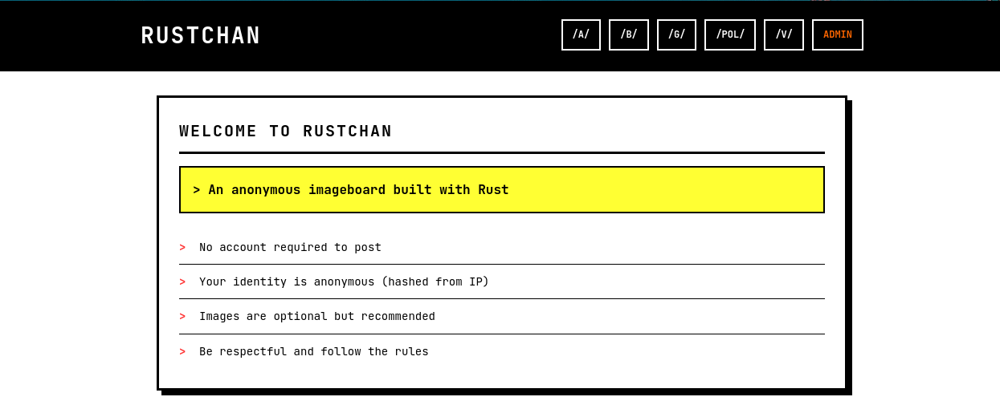
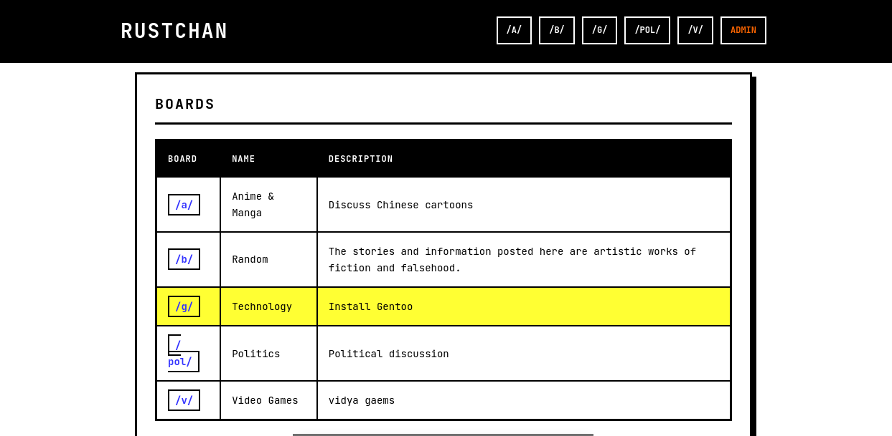
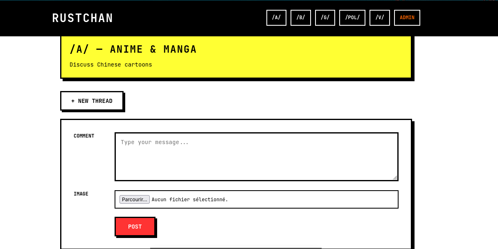

# RustChan.

An anonymous imageboard (4chan style) written in Rust.



## Stack

- **Backend**: Rust + Axum
- **Database**: SQLite (sqlx)
- **Templates**: Tera
- **Async**: Tokio

## Installation

```bash
# Build the project
cargo build --locked

# Run the public site (administration disabled until configured)
cargo run --locked

# With a custom port
PORT=3001 cargo run
```

## Administration and sessions

The old hard-coded administrator password and cookie-presence check have been removed.
Administration stays disabled until `RUSTCHAN_ADMIN_PASSWORD` is configured with
at least 16 characters. Public boards remain available without this variable.

For local development in Bash:

```bash
read -r -s -p "Admin password (16+ characters): " RUSTCHAN_ADMIN_PASSWORD
export RUSTCHAN_ADMIN_PASSWORD
export RUSTCHAN_SECURE_COOKIES=false  # local HTTP only
cargo run --locked
```

For production, set the password in your hosting provider's secret configuration,
serve the application over HTTPS, and keep `RUSTCHAN_SECURE_COOKIES=true` (the default).
Restart the process after changing the password. `.env` files are **not** loaded automatically.

- Sessions use random 256-bit tokens checked against a server-side session store.
- Sessions expire after 8 hours, are revoked on logout, and are cleared on restart.
- Cookies use `HttpOnly`, `SameSite=Strict`, and `Secure` by default.
- Administrative writes require POST plus a CSRF token tied to the current session.
- Sign-in is limited to 20 attempts per minute across the process. This global limit
  deliberately avoids trusting client-supplied proxy headers; a busy deployment
  can add a per-client limiter at its trusted reverse proxy.
- Only raster-image upload signatures are accepted (PNG, JPEG, GIF, WebP), with
  server-selected extensions. Upload responses are sandboxed and use `nosniff`,
  including uploads made before this update. Signature checks are not full image decoding.

The session store is local to one process and holds at most 64 sessions. A deployment
with multiple replicas needs a shared session store or sticky sessions. Existing
sessions are intentionally invalidated by this update.

## Verification

```bash
cargo fmt --all -- --check
cargo clippy --locked --all-targets -- -D warnings
cargo test --locked
```

Regression tests exercise forged and expired sessions, logout, cross-origin login,
CSRF protection, administrative board changes and upload response headers.

## Structure

```
src/
  main.rs      # Entry point, routes
  db/          # Database operations
  handlers/    # HTTP handlers
  models/      # Data structures
templates/     # Tera templates
static/        # CSS, images
uploads/       # Uploaded images
```

## Features

- Board creation and management
- Threads and posts with/without images
- Administration panel
- Image uploading
- Admin authentication system

## Useful commands

```bash
# Check the code without compiling
cargo check

# Linter
cargo clippy

# Format the code
cargo fmt
```




